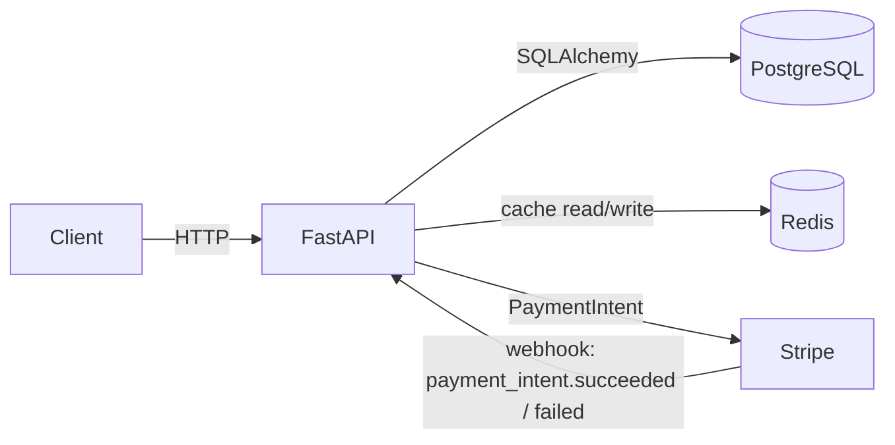

# E-commerce API

A production-style RESTful e-commerce backend with role-based admin access, atomic stock management, Stripe test-mode payments (PaymentIntents + webhooks), product reviews with a verified-purchase rule, Redis caching, and a fully Dockerized stack.

<!-- Replace OWNER/REPO with your GitHub path to activate the badge -->


---

## Features

- **JWT authentication** — register / login / `me`, bcrypt-hashed passwords.
- **Admin RBAC** — `role`-based access; only admins can create/update/delete products.
- **Products catalog** — public reads, admin writes.
- **Orders with atomic stock management** — row-locked, all-or-nothing stock decrement (409 on insufficient stock).
- **Stripe test-mode payments** — `PaymentIntent` creation + signature-verified webhook confirmation.
- **Failed-payment handling** — webhook cancels the order and restocks items (idempotent).
- **Product reviews** — one review per user per product, allowed only after a verified purchase.
- **Redis caching** — read-through product catalog with invalidation on write (fail-open).
- **Background tasks** — async order-confirmation notification after successful payment.
- **Dockerized** — API + Postgres + Redis via Docker Compose.
- **Tested + CI** — pytest suite run on every push via GitHub Actions.

---

## Tech Stack

| Tool | Role |
|------|------|
| **FastAPI** | Web framework |
| **Uvicorn** | ASGI server |
| **SQLAlchemy** | ORM |
| **PostgreSQL** | Database (SQLite for local tests) |
| **Alembic** | Database migrations |
| **Pydantic v2 + pydantic-settings** | Validation & config |
| **python-jose** | JWT auth |
| **passlib[bcrypt]** (`bcrypt==4.0.1`) | Password hashing |
| **Redis** | Caching layer |
| **Stripe** | Payments (test mode) |
| **Docker + Docker Compose** | Containerized stack |
| **pytest + httpx** | Testing |
| **GitHub Actions** | CI |

---

## Architecture



The API reaches Postgres and Redis by their Docker Compose **service names** (`db`, `redis`). Stripe is called outbound to create PaymentIntents, and calls back inbound to the webhook to confirm or fail payments.

---

## Setup

### Option A — Docker Compose (recommended)

Runs the API, Postgres, and Redis together; migrations apply automatically on startup.

1. Clone and enter the project:
   ```
   git clone <url>
   cd EcommerceAPI
   ```
2. Create your `.env` from the example and fill in the values:
   ```
   copy .env.example .env
   ```
   See [Environment variables](#environment-variables) below.
3. Start the stack:
   ```
   docker compose up --build
   ```
4. Verify:
   - Health check: http://localhost:8000/health
   - Interactive docs: http://localhost:8000/docs

### Option B — Local virtual environment

1. Create and activate a venv:
   ```
   python -m venv shopenv
   .\shopenv\Scripts\Activate
   ```
2. Install dependencies:
   ```
   pip install -r requirements.txt
   ```
3. Create `.env` from `.env.example`, then run migrations and start the server:
   ```
   alembic upgrade head
   uvicorn main:app --reload
   ```
   (For local runs, Postgres and Redis must be reachable per your `.env`; cache calls fail open if Redis is unavailable.)

### Testing Stripe webhooks locally

Payment confirmation is webhook-driven, so use the [Stripe CLI](https://stripe.com/docs/stripe-cli):

```
stripe listen --events payment_intent.succeeded,payment_intent.payment_failed --forward-to localhost:8000/payments/webhook
```

Copy the printed `whsec_...` value into `STRIPE_WEBHOOK_SECRET` in your `.env` and restart the API.

---

## Environment variables

| Variable | Required | Description |
|---|---|---|
| `DATABASE_URL` | yes | SQLAlchemy connection string (e.g. `postgresql://shop:secret@db:5432/ecommerce_db`). |
| `SECRET_KEY` | yes | JWT signing secret (e.g. `secrets.token_hex(32)`). |
| `STRIPE_SECRET_KEY` | yes | Stripe **test** secret key (`sk_test_...`). |
| `STRIPE_WEBHOOK_SECRET` | yes | Stripe webhook signing secret (`whsec_...`). |
| `REDIS_URL` | no | Defaults to `redis://localhost:6379/0` (compose overrides to `redis://redis:6379/0`). |
| `ALGORITHM` | no | JWT algorithm, defaults to `HS256`. |
| `ACCESS_TOKEN_EXPIRY_MINUTES` | no | Token lifetime, defaults to `30`. |

> `.env`, `*.db`, and the virtualenv are gitignored — recreate them locally.

---

## Endpoints

| Method | Endpoint | Auth | Description |
|---|---|---|---|
| `POST` | `/users/register` | public | Register a new user |
| `POST` | `/users/login` | public | Log in (OAuth2 form), returns JWT |
| `GET` | `/users/me` | user | Current user profile |
| `GET` | `/products` | public | List products (cached) |
| `GET` | `/products/{id}` | public | Product detail (cached) |
| `POST` | `/products` | admin | Create product |
| `PATCH` | `/products/{id}` | admin | Update product |
| `DELETE` | `/products/{id}` | admin | Delete product |
| `POST` | `/orders` | user | Create order (validates & decrements stock) |
| `GET` | `/orders` | user | List own orders |
| `GET` | `/orders/{id}` | user/admin | Order detail (owner or admin) |
| `POST` | `/orders/{id}/pay` | user | Create Stripe PaymentIntent for the order |
| `POST` | `/products/{id}/reviews` | user | Review a purchased product |
| `GET` | `/products/{id}/reviews` | public | List a product's reviews |
| `POST` | `/payments/webhook` | Stripe (signed) | Payment confirmation / failure |
| `GET` | `/health` | public | Health check |

---

## Payment flow

1. **Create order** — `POST /orders` validates stock, decrements it atomically, and records the order as `pending`.
2. **Start payment** — `POST /orders/{id}/pay` creates a Stripe `PaymentIntent` (amount in cents, `metadata.order_id` attached) and returns its `client_secret`.
3. **Confirm** — the payment is completed client-side / via the Stripe CLI (`pm_card_visa` for success).
4. **Webhook** — Stripe calls `POST /payments/webhook`:
   - `payment_intent.succeeded` → order marked **paid**, async confirmation notification queued.
   - `payment_intent.payment_failed` → order marked **cancelled** and item stock **restocked**.

The webhook verifies Stripe's signature against `STRIPE_WEBHOOK_SECRET` and is idempotent (safe on redelivery).

---

## Running tests

```
pytest -v
```

Tests use an isolated SQLite database (overriding `get_db`), mock Stripe at the boundary, and rely on the cache's fail-open behavior, so no Postgres or Redis is required. The same suite runs in CI on every push via [GitHub Actions](.github/workflows/tests.yml).

---

## Project structure

```
EcommerceAPI/
├── main.py                 # App entry point — includes routers, /health
├── config.py               # Settings from environment (pydantic-settings)
├── database.py             # Engine, SessionLocal, Base, get_db
├── models.py               # Users, Products, Order, OrderItem, Review
├── schemas.py              # Pydantic request/response shapes
├── security.py             # Password hashing, JWT, get_current_user, require_admin
├── cache.py                # Redis client
├── notifications.py        # Background-task order confirmation
├── routers/
│   ├── users.py            # register, login, me
│   ├── products.py         # product CRUD (admin writes, cached reads)
│   ├── orders.py           # orders, atomic stock, pay (PaymentIntent)
│   ├── reviews.py          # verified-purchase reviews
│   └── payments.py         # Stripe webhook
├── alembic/                # Migrations
├── tests/                  # pytest suite + fixtures
├── Dockerfile
├── docker-compose.yml      # API + Postgres + Redis
└── requirements.txt
```

